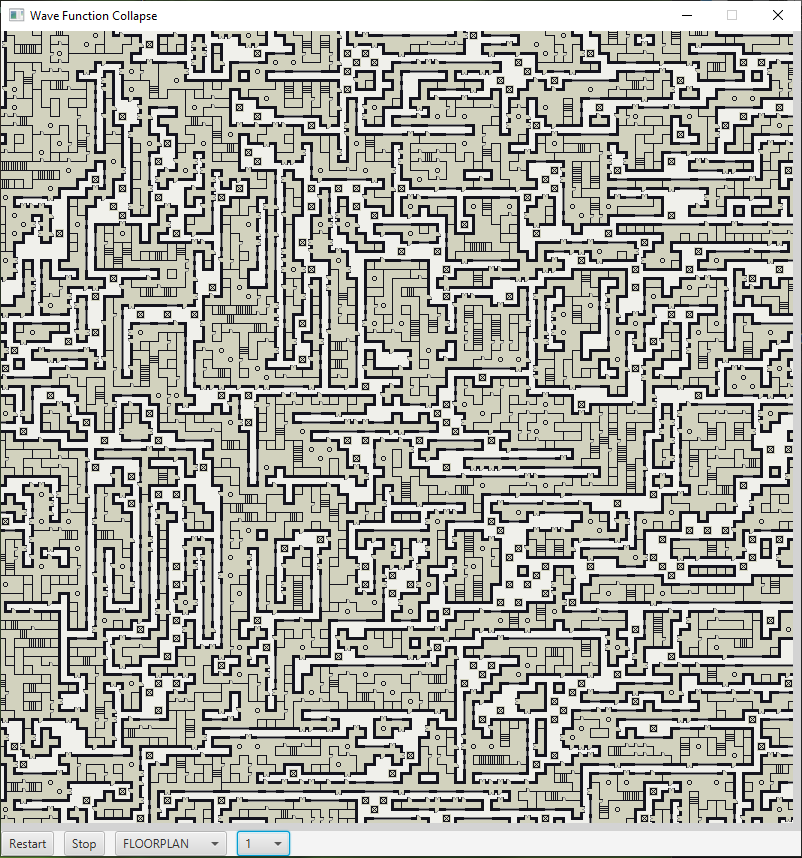

# Wave Function Collapse

A JavaFX visualization of the Wave Function Collapse algorithm: a board is built
one tile at a time, always choosing the tile that keeps its neighbours
consistent, and backing out of dead ends until the whole board is filled.



## Features

- Real time animation of the generation (one drawing operation per frame)
- Several tile sets: hand made ones, and ones sampled from a bitmap
- Rotated and mirrored variants generated automatically from each base tile
- Backtracking with a bounded history, plus area clearing when a region gets
  permanently stuck
- Fast mode checkbox: switches the pacing in the middle of a run without
  restarting it; the generation in progress is kept and its result is painted
  directly, skipping the queued drawing steps
- Reproducible patterns thanks to a configurable seed
- Configurable canvas size, tile set and zoom, from the user interface or the
  command line

## Requirements

| Requirement | Version |
|---|---|
| JDK | 17 or newer |
| JavaFX SDK | 21 (or any 17+ release) |

JavaFX is not part of the JDK, so it has to be downloaded separately (for
example from <https://gluonhq.com/products/javafx/>) and added as a module. The
examples below assume the SDK is unpacked at:

- Windows: `C:\Program Files\Java\javafx-sdk-21.0.8`
- Linux: `/opt/javafx-sdk-21.0.8`

Only the `javafx.controls` module is needed; it pulls in `javafx.graphics` and
`javafx.base`.

## Project layout

```
src/principal/
  WaveFunction.java   JavaFX application: window, controls, command line
  WfcSolver.java      generation loop and backtracking (runs on its own thread)
  TileBoard.java      the grid: placement, compatibility rules, entropy scan
  TileSet.java        the available tile sets: where their tiles come from, and
                      the loaded tiles themselves
  Tile.java           one tile: four independent sides and its graphic
  TileImageOps.java   pixel procedures used to derive variants (mirror, rotate,
                      copy a region of a sample)
  Renderer.java       draws the board, one queued operation per frame

resources/            tile images and sample images (must be on the classpath)
png/                  screenshots used by this document
```

## Compiling and running

The tile images are loaded with `getResource("/<set>/<tile>.png")`, so the
compiled classes (`out`) **and** the `resources` folder have to be on the
classpath. Use `;` as separator on Windows and `:` on Linux.

### Windows (cmd.exe)

```bat
set JFX_LIB=C:\Program Files\Java\javafx-sdk-21.0.8\lib

javac -encoding UTF-8 -d out --module-path "%JFX_LIB%" --add-modules javafx.controls src\principal\*.java

java --module-path "%JFX_LIB%" --add-modules javafx.controls -cp "out;resources" principal.WaveFunction
```

### Windows (PowerShell)

```powershell
$jfx = "C:\Program Files\Java\javafx-sdk-21.0.8\lib"

javac -encoding UTF-8 -d out --module-path $jfx --add-modules javafx.controls src\principal\*.java

java --module-path $jfx --add-modules javafx.controls -cp "out;resources" principal.WaveFunction
```

### Linux / macOS

```bash
export JFX_LIB=/opt/javafx-sdk-21.0.8/lib

javac -encoding UTF-8 -d out --module-path "$JFX_LIB" --add-modules javafx.controls src/principal/*.java

java --module-path "$JFX_LIB" --add-modules javafx.controls -cp "out:resources" principal.WaveFunction
```

### Launcher script (Windows)

`run.bat` does the same thing with the paths already filled in. It compiles the
sources every time and forwards any argument to the application, so:

```bat
run.bat --width=1200 --height=800 --set=castle --seed=42
```

If your JavaFX SDK lives somewhere else, override the folder before calling it:

```bat
set JFX_HOME=D:\tools\javafx-sdk-21
run.bat
```

The launcher compiles into `out/` and picks its JDK from `JDK_HOME`, then from a
known JDK 17 installation, then from `JAVA_HOME`. If your `javac -version`
reports `1.8` and the build fails, point `JDK_HOME` to your JDK 17+ installation:

```bat
set JDK_HOME=C:\Program Files\Java\jdk-17.0.20.1
run.bat
```

### API documentation

The sources are documented with Javadoc. To build the HTML docs:

```bat
javadoc -encoding UTF-8 -private -d docs --module-path "%JFX_LIB%" --add-modules javafx.controls -sourcepath src -subpackages principal
```

`-Xdoclint:all,-missing` can be added to check the tags without complaining about
undocumented private fields.

## Command line options

| Option | Default | Description |
|---|---|---|
| `--width=<px>` | `800` | canvas width |
| `--height=<px>` | `800` | canvas height |
| `--set=<name>` | `circuit` | tile set to start with, by folder, constant or display name |
| `--seed=<long>` | random | seed of the generation |

The board size depends on the canvas and on the side of a pattern. In
overlapping sets the anchors sit one anchor step apart: one pattern pixel in
hard overlap, two in soft overlap; elsewhere a cell holds the whole tile.
Higher zoom reduces the number of cells.

Without `--seed`, every *Restart* picks a new random seed and prints it to the
console, so any pattern you like can be reproduced later with
`--seed=<that number>`. With `--seed`, *Restart* always rebuilds the same board.

## Controls

| Control | Effect |
|---|---|
| **Restart** | throws the board away and starts a new generation |
| **Stop** | stops the generation and discards pending drawing operations, leaving the canvas as it is |
| **Fast mode** | removes or restores the per-step watching delay; turning it on keeps the generation in progress and draws the finished board as soon as it ends |
| **Tile set** | loads another set and restarts |
| **Zoom** | changes the size of a tile pixel and restarts |

## Tile sets

| Set | Loading | Notes |
|---|---|---|
| `circuit`, `castle`, `knots`, `simple`, `floorPlan`, `rooms`, `circles` | hand written | each tile is declared inside `TileSet` with an 8 character border description |
| `NotKnot`, `Link`, `Knot`, `Maze`, `ColoredCity`, `City`, `Water` | sampled | every 3x3 window of the sample becomes a tile |
| `Flowers hardOverlap`, `Skyline hardOverlap`, `SimpleWall hardOverlap`, `Paths hardOverlap` | sampled, hard overlap | 3x3 windows whose anchors are one pixel apart, so neighbours share two lines and each side signs pairs of lines; `Flowers` and `Skyline` begin with a tile from the bottom row |
| `Flowers softOverlap`, `Skyline softOverlap`, `SimpleWall softOverlap`, `Paths softOverlap`, `ScaledMaze softOverlap` | sampled, soft overlap | the same samples with anchors two pixels apart, so neighbours share one line and each side signs a single line offset inwards on the side facing the previous tile; the tile drops its first row and last column so the painting order never matters; `Flowers` and `Skyline` begin with a tile from the bottom row |

A set knows both where its graphics live and which tiles it is made of, so the
list above is the whole content of `TileSet`. The tiles are read the first time
one of its accessors is called and never change afterwards, and the mirrors and
rotations of every base tile are derived immediately after.

The only thing that differs between the two groups is where the base tiles come
from, so that is the only part that is polymorphic: each constant of the enum is
given a loading strategy that carries the name of the set, the size of its tiles
and its base tiles. There are two of them, `HandWritten` (definitions written
inline, graphics loaded from `resources/<folder>/`) and `Sampled`
(`resources/sample/<name>.png` cut into windows, with the overlap and
from-bottom variants). The strategy fills the list it is given and nothing else,
so it never needs to reach back into the enum, and `Tile` does not point back at
its set either: shared loading, the palette of a sample and the accessors live in
`TileSet`. Overlapping samples generate their variants during loading, even for
original windows with the same signature, and keep one tile per signature. For
from-bottom sets, windows from the sample's bottom row produce only their
left-right mirror, which also counts as a bottom tile.

A sampled set chooses which symmetries of each window it generates when it is
created: `ROTATIONS`, `HORIZONTAL_MIRROR`, `VERTICAL_MIRROR`, or any combination
of them. The default keeps all of them, so every existing set is unchanged; a
set that must not be mirrored, for instance, can ask for rotations only.

## How a tile is described

Every tile has four sides of three zones each, described as `TTTRRRBBBLLL`.
Horizontal sides are read from left to right and vertical sides from top to
bottom. Two tiles are compatible when their facing sides are equal.

The description is the same everywhere: hand written definitions declare it in
full, so a corner is written twice, once on each of the two sides that meet
there. Sampled sets assign a letter to every color, or to every pair of colors
in hard overlap, and keep one tile per signature; overlapping samples
generate the variants of each window during loading.

A plain window exposes its outer lines, so for a pattern like this one:

```
A B C
D E F
G H I
```

the sides are `top = ABC`, `right = CFI`, `bottom = GHI` and `left = ADG`. A
hard overlap window shares two lines with each neighbour, so a zone of its
sides is the pair of lines that faces the neighbour, always written in reading
order: `top = AD BE CF`, `right = BC EF HI`, `bottom = DG EH FI` and
`left = AB DE GH`. A soft overlap window shares a single line, its anchors
sitting two pixels apart, and signs single lines again, offset inwards on the
side that faces the previous tile: `top = DEF`, `right = BEH`, `bottom = GHI`
and `left = ADG`, so the match carries the pattern one line further. Its image
drops the first row and the last column (the lines the upper and right
neighbours own), so every tile paints only its own lines and the painting order
never matters. When an image is rotated or mirrored, its sides are read again
from the transformed image. On the canvas overlapping tiles are spaced by the
anchor step of their mode; hard overlap overwrites the identical shared lines,
while soft overlap paints only the lines each tile owns.

## How the generation works

1. Seed the board. Sets that start from the bottom place a single soil tile in
   the bottom-left corner; any other set places a single random tile in the
   centre. Soil tiles end up confined to the bottom row by the solver itself,
   not by a positional guard: the top border of a soil tile matches ordinary
   tiles, but no tile has a soil border on its top side, so a soil tile placed
   in the middle starves the cell underneath it and the deadlock handling
   (steps 4 and 5) clears it again.
2. Find the placed tile with the fewest legal continuations around it. Ties are
   broken at random.
3. Collect the tiles that can be placed in its empty neighbours, respecting the
   border zones, and place one of them.
4. If no tile fits anywhere around it, break the deadlock: clear one neighbour,
   and if the same cell keeps failing, clear a 9x9 area around it.
5. Undo the most recent decisions until one of them has an option left, and try
   that option instead.
6. Stop when the board is full, when the remembered history is exhausted, or
   when the user asks to stop.

This is a pragmatic Wave Function Collapse rather than the canonical one: each
empty cell keeps a domain of fitting tiles (cached, and dropped and rebuilt
whenever a neighbour changes), but domains are only built from neighbours that
are already placed, so constraints never propagate through undecided cells.
A cell can therefore only be found impossible once its neighbours are painted,
and, because the history is bounded, "no solution found" is a memory limit and
not a proof: the same board usually succeeds with another seed.

## Notes on concurrency

- The generation runs on a single daemon thread owned by `WfcSolver`; the JavaFX
  thread only draws, so the window never freezes.
- Starting a new generation never blocks the user interface: a run id is
  incremented, the running generation sees the change on its next step and dies,
  and the new one is queued behind it. Two generations can never write to a
  board at the same time, and nothing is left half started if the previous run
  threw an exception.
- A `TileSet` is loaded once, in whichever thread asks for it first, and the
  resulting list of tiles is immutable. Every generation can therefore read the
  same set: there is nothing to copy and nothing to invalidate.
- Every generation owns its own `TileBoard`. The board is only touched by the
  generation thread, and a run that is still finishing writes to its own, older
  board, never to the one the user is already looking at.
- Changes reach the drawing side as immutable actions that carry the tile index
  and the tile set already resolved, in a `ConcurrentLinkedQueue`. Every
  generation draws through its own session. Stopping or replacing the session
  clears its pending actions and rejects late notifications, so an abandoned run
  cannot paint over the canvas.

## Known limitations

- Each step scans a live frontier of the placed cells that still touch an
  empty one, not the whole board, and the domains around every placement are
  rebuilt lazily on demand; boards much larger than the default (or a small
  zoom) are still slower simply because they need many more steps.
- Backtracking remembers only the last 300 decisions, and a region that keeps
  failing is cleared wholesale to get unstuck. The generation is therefore
  incomplete by design: it can miss boards a full search would find, and a
  "no solution found" message reports a given-up search, not an impossible
  puzzle.
- The first time a set is used its tiles are loaded, and for the sampled sets
  that means cutting out and decoding every window of the sample image; the very
  first generation of such a set may take a moment to start. Later generations
  reuse the same set.
- A long generation can queue more drawing operations than the canvas can paint
  at 60 per second, so the animation may lag behind the real state of the board.

## License

This project is open source and available under the MIT License.
